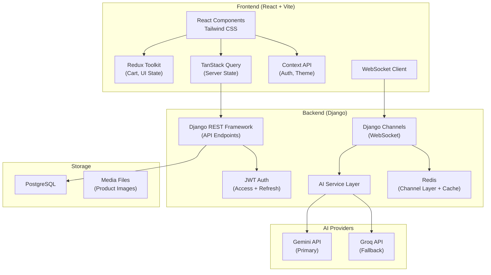
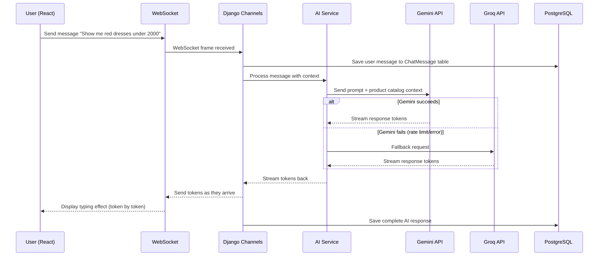
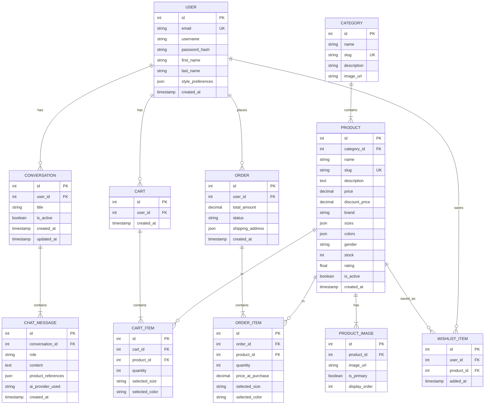

# AI Fashion Shopping Assistant — Full Project Blueprint

## Project Name: **StyleSense AI**

> An AI-powered fashion shopping assistant that uses conversational AI (Gemini + Groq fallback) to help users discover, compare, and shop for clothing through natural language.

---

## Architecture Overview



---

## Data Flow: How a Chat Message Works



---

## Project File Structure

```
stylesense-ai/
├── docker-compose.yml              # Orchestrate all services
├── docker-compose.dev.yml          # Dev overrides
├── .env.example                    # Environment variables template
├── README.md                       # Project documentation
│
├── backend/                        # Django project
│   ├── Dockerfile
│   ├── requirements.txt
│   ├── manage.py
│   ├── config/                     # Django project settings
│   │   ├── __init__.py
│   │   ├── settings/
│   │   │   ├── __init__.py
│   │   │   ├── base.py            # Shared settings
│   │   │   ├── development.py     # Dev settings (DEBUG=True)
│   │   │   └── production.py      # Prod settings
│   │   ├── urls.py                # Root URL config
│   │   ├── asgi.py                # ASGI config (for Channels)
│   │   └── wsgi.py                # WSGI config (for REST)
│   │
│   ├── apps/
│   │   ├── users/                 # User management
│   │   │   ├── models.py          # Custom User model
│   │   │   ├── serializers.py     # Registration, Login, Profile
│   │   │   ├── views.py           # Auth endpoints
│   │   │   ├── urls.py
│   │   │   ├── managers.py        # Custom user manager
│   │   │   ├── permissions.py     # Custom permissions
│   │   │   └── tests/
│   │   │       ├── test_models.py
│   │   │       ├── test_views.py
│   │   │       └── test_serializers.py
│   │   │
│   │   ├── products/              # Product catalog
│   │   │   ├── models.py          # Product, Category, ProductImage
│   │   │   ├── serializers.py
│   │   │   ├── views.py           # List, Detail, Search, Filter
│   │   │   ├── urls.py
│   │   │   ├── filters.py         # Django-filter for price/size/color
│   │   │   ├── management/
│   │   │   │   └── commands/
│   │   │   │       └── seed_products.py  # Seed fashion data
│   │   │   └── tests/
│   │   │       ├── test_models.py
│   │   │       └── test_views.py
│   │   │
│   │   ├── chat/                  # AI chatbot
│   │   │   ├── models.py          # Conversation, ChatMessage
│   │   │   ├── serializers.py
│   │   │   ├── views.py           # REST endpoints for history
│   │   │   ├── urls.py
│   │   │   ├── consumers.py       # WebSocket consumer
│   │   │   ├── routing.py         # WebSocket URL routing
│   │   │   └── tests/
│   │   │       ├── test_models.py
│   │   │       └── test_consumers.py
│   │   │
│   │   ├── cart/                   # Shopping cart
│   │   │   ├── models.py          # Cart, CartItem
│   │   │   ├── serializers.py
│   │   │   ├── views.py
│   │   │   ├── urls.py
│   │   │   └── tests/
│   │   │
│   │   ├── orders/                # Order management
│   │   │   ├── models.py          # Order, OrderItem
│   │   │   ├── serializers.py
│   │   │   ├── views.py
│   │   │   ├── urls.py
│   │   │   └── tests/
│   │   │
│   │   └── wishlist/              # Wishlist
│   │       ├── models.py
│   │       ├── serializers.py
│   │       ├── views.py
│   │       ├── urls.py
│   │       └── tests/
│   │
│   └── services/                  # Business logic layer
│       ├── __init__.py
│       ├── ai/
│       │   ├── __init__.py
│       │   ├── base.py            # Abstract AI provider interface
│       │   ├── gemini_provider.py # Gemini implementation
│       │   ├── groq_provider.py   # Groq implementation
│       │   ├── fallback.py        # Fallback orchestrator
│       │   ├── prompts.py         # System prompts + templates
│       │   └── context_builder.py # Build context from product DB
│       └── product_adapter/
│           ├── __init__.py
│           ├── base.py            # Abstract product source
│           ├── local_adapter.py   # Query local DB
│           └── api_adapter.py     # External API adapter (extensibility demo)
│
├── frontend/                      # React project (Vite)
│   ├── Dockerfile
│   ├── package.json
│   ├── vite.config.js
│   ├── tailwind.config.js
│   ├── postcss.config.js
│   ├── index.html
│   │
│   ├── public/
│   │   └── favicon.svg
│   │
│   └── src/
│       ├── main.jsx               # App entry point
│       ├── App.jsx                # Root component + routing
│       ├── index.css              # Tailwind imports + global styles
│       │
│       ├── api/                   # API layer
│       │   ├── axios.js           # Axios instance with interceptors
│       │   ├── auth.js            # Auth API calls
│       │   ├── products.js        # Product API calls
│       │   ├── chat.js            # Chat REST API calls
│       │   ├── cart.js            # Cart API calls
│       │   ├── orders.js          # Order API calls
│       │   └── wishlist.js        # Wishlist API calls
│       │
│       ├── hooks/                 # Custom hooks
│       │   ├── useAuth.js         # Auth context hook
│       │   ├── useWebSocket.js    # WebSocket connection hook
│       │   ├── useProducts.js     # TanStack Query: products
│       │   ├── useChat.js         # TanStack Query: chat history
│       │   ├── useCart.js         # TanStack Query: cart operations
│       │   └── useDebounce.js     # Debounce hook for search
│       │
│       ├── store/                 # Redux Toolkit
│       │   ├── index.js           # Store configuration
│       │   ├── cartSlice.js       # Cart state (optimistic updates)
│       │   └── uiSlice.js         # UI state (sidebar, modals)
│       │
│       ├── context/               # React Context
│       │   ├── AuthContext.jsx    # Auth state + JWT management
│       │   └── ThemeContext.jsx   # Dark/Light mode
│       │
│       ├── components/            # Reusable components
│       │   ├── layout/
│       │   │   ├── Navbar.jsx
│       │   │   ├── Sidebar.jsx
│       │   │   ├── Footer.jsx
│       │   │   └── Layout.jsx     # Main layout wrapper
│       │   │
│       │   ├── chat/
│       │   │   ├── ChatWindow.jsx       # Main chat container
│       │   │   ├── MessageBubble.jsx    # Single message display
│       │   │   ├── ChatInput.jsx        # Message input + send
│       │   │   ├── TypingIndicator.jsx  # AI typing animation
│       │   │   ├── ProductCard.jsx      # Product in chat response
│       │   │   └── ChatHistory.jsx      # Past conversations list
│       │   │
│       │   ├── products/
│       │   │   ├── ProductGrid.jsx      # Product grid layout
│       │   │   ├── ProductCard.jsx      # Product card
│       │   │   ├── ProductDetail.jsx    # Full product view
│       │   │   ├── ImageGallery.jsx     # Multi-image with zoom
│       │   │   ├── FilterSidebar.jsx    # Price/size/color filters
│       │   │   └── SearchBar.jsx        # AI-aware search
│       │   │
│       │   ├── cart/
│       │   │   ├── CartDrawer.jsx       # Slide-out cart
│       │   │   ├── CartItem.jsx         # Single cart item
│       │   │   └── CartSummary.jsx      # Price summary
│       │   │
│       │   └── common/
│       │       ├── Button.jsx
│       │       ├── Modal.jsx
│       │       ├── Loader.jsx
│       │       ├── Toast.jsx
│       │       └── ProtectedRoute.jsx   # Auth guard
│       │
│       ├── pages/                 # Page components
│       │   ├── Home.jsx           # Landing + featured products
│       │   ├── Chat.jsx           # AI chatbot page
│       │   ├── Products.jsx       # Browse + filter products
│       │   ├── ProductDetail.jsx  # Single product page
│       │   ├── Cart.jsx           # Full cart page
│       │   ├── Wishlist.jsx       # Saved items
│       │   ├── Orders.jsx         # Order history
│       │   ├── Login.jsx          # Login page
│       │   ├── Register.jsx       # Registration page
│       │   ├── Profile.jsx        # User profile
│       │   └── NotFound.jsx       # 404 page
│       │
│       └── utils/                 # Utilities
│           ├── constants.js       # API URLs, config
│           ├── helpers.js         # Format price, truncate text
│           └── validators.js      # Form validation
│
└── nginx/                         # Reverse proxy (production)
    ├── Dockerfile
    └── nginx.conf
```

---

## Database Schema



---

## Feature Breakdown with Interview Talking Points

### 1. JWT Authentication (Week 1)

| What you build | What interviewer asks | Your answer |
|---|---|---|
| Custom User model | "Why custom user?" | "Django default user uses username. Real apps use email. I extended `AbstractBaseUser` for full control." |
| Register/Login endpoints | "How password stored?" | "Django uses PBKDF2 with SHA256 by default. I never store plain text." |
| Access + Refresh tokens | "Why two tokens?" | "Access token short-lived (5 min) for security. Refresh token longer (7 days) to avoid re-login. If access stolen, damage limited." |
| Axios interceptor | "What if access token expires mid-request?" | "Axios interceptor catches 401, uses refresh token to get new access token, retries original request. User never sees interruption." |
| Protected routes | "How frontend knows user logged in?" | "AuthContext stores JWT in memory (not localStorage for XSS safety). On refresh, call `/api/token/refresh/` endpoint." |

### 2. Product Catalog + Search (Week 2)

| What you build | What interviewer asks | Your answer |
|---|---|---|
| Product model with JSON fields | "Why JSON for sizes/colors?" | "Fashion products have variable attributes. JSON field more flexible than separate tables for this use case. PostgreSQL indexes JSON natively." |
| Django-filter integration | "How filtering works?" | "django-filter auto-generates filter backends from model fields. I defined custom FilterSet for price range, multi-select colors, size availability." |
| TanStack Query for fetching | "Why not Redux for API data?" | "Server state (products) differs from client state (cart). TanStack Query handles caching, background refetch, stale-while-revalidate. Redux would need manual cache invalidation." |
| Image gallery with zoom | "How zoom works?" | "CSS transform: scale() on hover/click. No heavy library needed. Intersection Observer for lazy loading off-screen images." |
| Seed data management command | "How you populated data?" | "Django management command. Can run `python manage.py seed_products` to populate 50+ products with realistic fashion data. Idempotent — safe to run multiple times." |

### 3. AI Chatbot Core (Week 3-4)

| What you build | What interviewer asks | Your answer |
|---|---|---|
| WebSocket consumer | "Why WebSocket not REST for chat?" | "REST = request-response. User waits for full AI response. WebSocket = stream tokens as they generate. 3x better perceived performance. Like ChatGPT typing effect." |
| AI provider abstraction | "How fallback works?" | "Abstract base class defines `generate()` interface. `FallbackOrchestrator` tries Gemini first, catches exceptions, falls back to Groq. Open/Closed principle — add new provider without changing existing code." |
| Prompt engineering | "How AI know about your products?" | "Context builder queries relevant products from DB based on user message, injects into system prompt. AI sees product catalog as context, not training data. This is RAG-lite pattern." |
| Chat history | "How conversation context maintained?" | "Last N messages sent with each request. Conversation model groups messages. User can resume past conversations with full context." |
| Streaming response | "How streaming works technically?" | "Gemini API supports `stream=True`. Each chunk sent through WebSocket as it arrives. Frontend appends to message bubble in real-time." |

### 4. Cart + Wishlist + Orders (Week 5)

| What you build | What interviewer asks | Your answer |
|---|---|---|
| Redux cart slice | "Why Redux for cart, not TanStack Query?" | "Cart is client state — user adds/removes frequently, needs instant UI feedback. Redux gives synchronous updates. I sync to server in background (optimistic updates)." |
| Optimistic updates | "What if server rejects cart update?" | "Update UI immediately, send API call. If fails, rollback Redux state and show toast error. Better UX than waiting for server." |
| Order creation | "How you handle race conditions?" | "Django `select_for_update()` locks product row during stock check. Transaction atomic ensures stock decrement and order creation succeed together or not at all." |
| Wishlist with AI integration | "How AI and wishlist connect?" | "When AI recommends product, 'Add to Wishlist' button appears in chat. Saves product reference from AI response. User can view all AI-recommended saves later." |

### 5. Testing (Throughout)

| What you build | What interviewer asks | Your answer |
|---|---|---|
| Django API tests | "What you test?" | "Every endpoint: valid/invalid input, auth required, permissions. Factory Boy for test data. 70%+ coverage." |
| WebSocket tests | "How you test WebSocket?" | "Django Channels provides `WebsocketCommunicator` for testing consumers without real WebSocket connection." |
| React component tests | "Testing approach?" | "React Testing Library — test behavior, not implementation. 'Does clicking Add to Cart update count?' not 'Does state.items.length equal 1?'" |

### 6. Docker + Deployment (Week 6)

| What you build | What interviewer asks | Your answer |
|---|---|---|
| Multi-stage Dockerfile | "Why multi-stage?" | "First stage installs dependencies + builds. Second stage copies only artifacts. 60% smaller production image." |
| docker-compose | "What services?" | "4 services: Django (Daphne for ASGI), React (Nginx), PostgreSQL, Redis. One `docker-compose up` starts everything." |
| Environment configs | "How you manage secrets?" | "`.env` file for local, environment variables in Render/Vercel for prod. Never commit secrets. `.env.example` shows required vars without values." |
| CI/CD awareness | "Any automation?" | "GitHub Actions: lint, test, build on PR. Deploy on merge to main. Even if not fully implemented, I understand the pipeline." |

---

## 6-Week Phased Learning Plan

### Week 1: Foundation + Auth
**Goal: Django project setup + JWT authentication working end-to-end**

```
Day 1-2: Project Setup
├── Initialize Django project with split settings
├── Initialize React project with Vite
├── Setup PostgreSQL with Docker
├── Configure Tailwind CSS
├── Create docker-compose.yml
└── LEARN: Why ASGI vs WSGI. What is ASGI? Why Django Channels need it?

Day 3-4: Custom User Model + JWT
├── Build Custom User model (AbstractBaseUser)
├── Install djangorestframework-simplejwt
├── Create Register/Login/Refresh endpoints
├── Write serializers with validation
├── Write tests for auth endpoints
└── LEARN: How JWT works internally. What's in header/payload/signature? Why base64?

Day 5-7: React Auth
├── Setup AuthContext with JWT storage
├── Build Login/Register pages
├── Create Axios instance with interceptors
├── Implement token refresh logic
├── Build ProtectedRoute component
└── LEARN: Why store token in memory, not localStorage? XSS vs CSRF tradeoffs.
```

### Week 2: Product Catalog
**Goal: Products browsable with filters + search**

```
Day 1-2: Django Product Models
├── Create Product, Category, ProductImage models
├── Build seed_products management command
├── Create serializers (nested ProductImage)
├── Setup django-filter for filtering
└── LEARN: QuerySet optimization. select_related vs prefetch_related. N+1 problem.

Day 3-4: Product API + Tests
├── Build ViewSets (List, Detail, Search)
├── Add pagination (cursor-based)
├── Write comprehensive API tests
└── LEARN: Why cursor pagination, not offset? What happens at 100k products with offset?

Day 5-7: React Product Pages
├── Setup TanStack Query
├── Build ProductGrid, ProductCard components
├── Build FilterSidebar with URL params
├── Build ImageGallery with zoom
├── Build SearchBar with debounce
└── LEARN: How TanStack Query cache works. staleTime vs gcTime. Why infinite query for pagination?
```

### Week 3: AI Integration
**Goal: Gemini API working, basic chat functional**

```
Day 1-2: AI Service Layer
├── Create abstract AI provider base class
├── Implement GeminiProvider
├── Implement GroqProvider
├── Build FallbackOrchestrator
├── Write unit tests for fallback logic
└── LEARN: Strategy pattern. Open/Closed principle. Why abstract base class?

Day 3-4: Context Builder
├── Build prompt templates
├── Create context_builder that queries relevant products
├── Test prompt quality with different user inputs
└── LEARN: Prompt engineering basics. System vs user prompt. Temperature. Token limits.

Day 5-7: REST Chat Endpoint (before WebSocket)
├── Create Conversation, ChatMessage models
├── Build REST endpoint for sending message
├── Test with Postman/Thunder Client
├── Connect React ChatWindow to REST API
└── LEARN: Why build REST first before WebSocket? Iterative complexity management.
```

### Week 4: Real-time Chat
**Goal: WebSocket streaming working, chat feels like ChatGPT**

```
Day 1-2: Django Channels Setup
├── Install channels + channels-redis
├── Configure ASGI application
├── Setup Redis with Docker
├── Create ChatConsumer (WebSocket)
├── Define WebSocket routing
└── LEARN: ASGI vs WSGI deep dive. Channel layers. Why Redis needed?

Day 3-4: Streaming Implementation
├── Stream AI response through WebSocket
├── Handle connection/disconnection
├── Add authentication to WebSocket
└── LEARN: WebSocket lifecycle. How auth works differently in WS vs HTTP?

Day 5-7: React WebSocket Client
├── Build useWebSocket custom hook
├── Implement typing indicator
├── Build message streaming display
├── Build ChatHistory sidebar
├── Product cards inside chat responses
└── LEARN: Reconnection strategy. Exponential backoff. Why custom hook not library?
```

### Week 5: Cart, Wishlist, Orders
**Goal: Full shopping flow working**

```
Day 1-2: Redux Toolkit Setup
├── Create store with cartSlice, uiSlice
├── Build CartDrawer component
├── Implement optimistic updates
└── LEARN: Redux middleware. Thunks vs RTK Query. When Redux overkill?

Day 3-4: Cart + Wishlist Backend
├── Cart model + API endpoints
├── Wishlist model + API endpoints
├── Connect AI recommendations to wishlist
├── Write tests
└── LEARN: Database transactions. select_for_update. Race conditions in e-commerce.

Day 5-7: Orders
├── Order creation flow
├── Order history page
├── Stock validation on order
└── LEARN: Idempotency in order creation. What if user double-clicks "Place Order"?
```

### Week 6: Polish + Deploy
**Goal: Production-ready, deployed, documented**

```
Day 1-2: Testing + Polish
├── Reach 70%+ test coverage
├── Fix edge cases
├── Add loading states, error boundaries
├── Dark/Light mode with ThemeContext
└── LEARN: Error boundaries in React. Why error boundary is class component?

Day 3-4: Docker + Deployment
├── Multi-stage Dockerfiles
├── Production docker-compose
├── Deploy Django to Render
├── Deploy React to Vercel
├── Setup environment variables
└── LEARN: Container vs VM. Why multi-stage build? What is reverse proxy?

Day 5-7: Documentation + Portfolio
├── Write comprehensive README
├── Add API documentation (DRF browsable API)
├── Record demo video/GIF
├── Write about challenges faced
├── Prepare interview talking points
└── LEARN: How to present project in interview. STAR method for technical questions.
```

---

## Key Technologies Summary

| Layer | Technology | Why this one |
|---|---|---|
| Frontend framework | React 18 + Vite | Industry standard. Vite for fast dev server. |
| Styling | Tailwind CSS | Rapid UI development. High job demand. |
| Server state | TanStack Query v5 | Caching, background refetch, loading states. |
| Client state | Redux Toolkit | Cart, UI state. Interview favorite. |
| Auth state | Context API | Simple, no external library needed. |
| Routing | React Router v6 | Standard. Nested routes, protected routes. |
| Backend framework | Django 5 + DRF | Battle-tested. Great ORM. |
| Real-time | Django Channels | WebSocket support for Django. |
| Database | PostgreSQL 16 | Production-grade. JSON field support. |
| Cache/Broker | Redis | Channel layer for Channels. Optional caching. |
| AI Primary | Google Gemini API | Generous free tier. Streaming support. |
| AI Fallback | Groq API | Fast inference. Free tier. |
| Container | Docker + Compose | Consistent environments. DevOps skill. |
| Deploy (backend) | Render | Free tier. PostgreSQL included. |
| Deploy (frontend) | Vercel | Free. Perfect for React/Vite. |
| Testing (backend) | pytest + Factory Boy | Better than unittest. Fixtures. |
| Testing (frontend) | Jest + React Testing Library | Behavior-driven testing. |

---

## Interview Power Moves

Things that make interviewer say "this person thinks like engineer":

1. **Split settings** (base/dev/prod) — not one `settings.py` with `if DEBUG`
2. **Abstract AI provider** — strategy pattern, not `if provider == 'gemini'`
3. **TanStack Query + Redux separation** — server state vs client state awareness
4. **Optimistic updates** — understand UX impact of network latency
5. **Cursor pagination** — know why offset bad at scale
6. **JWT in memory** — security-first thinking
7. **WebSocket for streaming** — not REST polling
8. **Docker compose** — "works everywhere" mindset
9. **Management command for seed data** — reproducible data setup
10. **Tests that test behavior** — not implementation details

> [!IMPORTANT]
> **Ready to start building?** Approve this plan and we begin with Week 1, Day 1: project initialization + Docker setup. I'll guide you through every file, explain every decision, and make sure you can defend each choice in interview.
