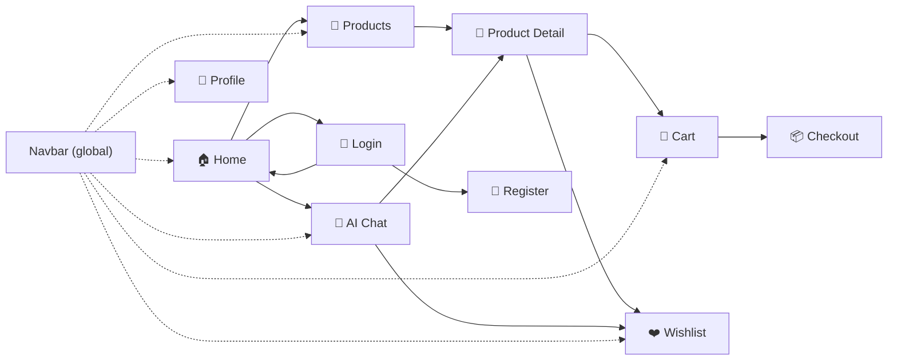

# StyleSense AI — UI Design Guide & Google Stitch Prompts

## UI Approach: Industry Standard Options

| Approach | How it works | Best for | Downside |
|---|---|---|---|
| **Atomic Design** (Brad Frost) | Atoms → Molecules → Organisms → Templates → Pages | Design systems at scale (Google, IBM) | Overkill for solo project |
| **Feature-Based** | Complete one feature's UI fully, then next | Quick MVPs | Inconsistent design across features |
| **Design System First** | Define tokens + base components → compose pages | Portfolio projects, team handoff | Upfront time before visible pages |

### Recommendation: **Hybrid — Design System First + Page-by-Page**

```
Phase 1: Design Tokens (colors, fonts, spacing, shadows)
Phase 2: Base Components (buttons, inputs, cards, modals)
Phase 3: Pages (compose from base components, one at a time)
```

**Why this for your portfolio:**
- Interviewer sees consistency across every page
- "I built a design system" = senior-level talking point
- Changing theme later = change tokens, everything updates
- Matches how real companies (Airbnb, Shopify) work

---

## Component Hierarchy

```mermaid
graph TD
    subgraph DesignTokens["Design Tokens"]
        COLORS["Colors"]
        TYPO["Typography"]
        SPACE["Spacing"]
        SHADOW["Shadows"]
    end

    subgraph BaseComponents["Base Components (Shared)"]
        BTN["Button"]
        INPUT["Input"]
        BADGE["Badge"]
        AVATAR["Avatar"]
        TOAST["Toast"]
        MODAL["Modal"]
        LOADER["Skeleton Loader"]
    end

    subgraph CompositeComponents["Composite Components"]
        NAVBAR["Navbar"]
        FOOTER["Footer"]
        PCARD["ProductCard"]
        CARTITEM["CartItem"]
        MSGBUBBLE["MessageBubble"]
        FILTERBAR["FilterSidebar"]
        IMGGALLERY["ImageGallery"]
    end

    subgraph Pages["Pages"]
        HOME["Home"]
        CHAT["AI Chat"]
        PRODUCTS["Products"]
        DETAIL["Product Detail"]
        CART["Cart"]
        WISHLIST["Wishlist"]
        ORDERS["Orders"]
        AUTH["Login / Register"]
        PROFILE["Profile"]
    end

    DesignTokens --> BaseComponents
    BaseComponents --> CompositeComponents
    CompositeComponents --> Pages
```



---

## Page Flow Diagram



---

## Design Tokens (Extracted from POVERIA Reference)

```
COLOR PALETTE:
─────────────────────────────────────────
Primary Black:      #1A1A1A  (headings, CTAs)
Text Dark:          #333333  (body text)
Text Muted:         #777777  (secondary text, labels)
Text Light:         #AAAAAA  (placeholders, disabled)
Border:             #E5E5E5  (dividers, card borders)
Background White:   #FFFFFF  (primary background)
Background Cream:   #F9F7F4  (section backgrounds, hover states)
Background Light:   #F5F5F5  (input backgrounds, cards)
Accent Warm:        #C9A96E  (subtle gold for premium touches — ratings, badges)
Success:            #2D8A4E  (in stock, order confirmed)
Error:              #D64045  (out of stock, validation errors)
AI Accent:          #6366F1  (AI chat bubbles, AI badge — indigo to differentiate AI)

TYPOGRAPHY:
─────────────────────────────────────────
Heading Font:       "Playfair Display", serif  (editorial, luxury feel)
Body Font:          "Inter", sans-serif  (clean, readable)
Heading Sizes:      H1: 48px, H2: 36px, H3: 24px, H4: 18px
Body Sizes:         Large: 18px, Base: 16px, Small: 14px, XS: 12px
Font Weights:       Light: 300, Regular: 400, Medium: 500, Semibold: 600, Bold: 700
Letter Spacing:     Headings: -0.02em, Body: 0, Uppercase Labels: 0.1em

SPACING:
─────────────────────────────────────────
4px grid system: 4, 8, 12, 16, 24, 32, 48, 64, 96, 128
Section padding: 96px vertical (desktop), 48px (mobile)
Container max-width: 1280px, centered

SHADOWS:
─────────────────────────────────────────
Card:    0 1px 3px rgba(0,0,0,0.06)
Hover:   0 4px 12px rgba(0,0,0,0.08)
Modal:   0 16px 48px rgba(0,0,0,0.12)
Navbar:  0 1px 0 #E5E5E5 (border, not shadow)

BORDERS:
─────────────────────────────────────────
Radius:  none (0px) for buttons/inputs = editorial feel
         8px for cards
         full (50%) for avatars
Width:   1px for borders, 2px for focus states

TRANSITIONS:
─────────────────────────────────────────
Default: 200ms ease
Hover:   150ms ease-in-out
Page:    300ms ease
```

---

## Google Stitch Prompts

> [!TIP]
> Use these prompts one at a time in Google Stitch. Each prompt designed to be self-contained with all needed context.

---

### Prompt 1: Home / Landing Page

```
Design a premium fashion e-commerce landing page for "StyleSense AI" — an AI-powered fashion shopping assistant.

AESTHETIC: Minimal, editorial, high-fashion magazine style. Clean black and white with cream/beige accents. Generous whitespace. No clutter.

COLOR PALETTE: Primary black #1A1A1A, background white #FFFFFF, cream sections #F9F7F4, muted text #777777, borders #E5E5E5, warm gold accent #C9A96E.

TYPOGRAPHY: "Playfair Display" serif for headings (large, elegant). "Inter" sans-serif for body. Uppercase tracking on labels and navigation.

LAYOUT (top to bottom):
1. NAVBAR: Full-width. Left: search icon + "Search products..." text. Center: "STYLESENSE AI" logo in elegant serif. Right: user icon, wishlist heart with count badge, cart bag with count badge. Below logo: horizontal nav links — HOME, SHOP, COLLECTIONS, AI STYLIST, ABOUT — in uppercase small tracking.

2. HERO SECTION: Full-width split layout. Left 55%: large heading "Discover Your Perfect Style" in serif, subtext "AI-powered fashion that understands you" in muted sans-serif, two buttons — "CHAT WITH AI STYLIST" (solid black, white text, sharp corners) and "BROWSE COLLECTION" (outlined black, transparent). Right 45%: large editorial fashion photo of a woman in minimal clothing against a light background.

3. AI FEATURE BANNER: Cream background #F9F7F4. Centered content. Small uppercase label "AI-POWERED SHOPPING". Heading "Your Personal AI Stylist". Three feature cards in a row — each with a minimal icon, title, and one-line description: "Smart Recommendations" (AI analyzes your style), "Natural Conversations" (chat like talking to a friend), "Instant Comparisons" (compare products effortlessly). Clean card style with no heavy borders.

4. TRENDING PRODUCTS: White background. Section heading "Trending Now" in serif, "VIEW ALL" link on the right. 4-column grid of product cards. Each card: product image with slight hover zoom effect, brand name in uppercase small text, product name, price in bold, small heart icon top-right for wishlist. No heavy borders — subtle shadow on hover.

5. COLLECTION BANNERS: Two-column layout. Left: tall image with overlay text "Summer Essentials" and "SHOP NOW" link. Right: two stacked smaller banners — "New Arrivals" and "Best Sellers". Editorial photography style.

6. FEATURES BAR: Row of 4 feature badges with thin top border: "Free Shipping", "AI Styling", "Easy Returns", "Secure Checkout" — each with a minimal line icon.

7. FOOTER: Black background #1A1A1A, white text. 4-column grid: About (brand description), Quick Links, Customer Service, Newsletter signup with email input and "SUBSCRIBE" button. Bottom: copyright + social icons.

RESPONSIVE: Design desktop (1280px) version. Clean grid, generous spacing between sections.
```

---

### Prompt 2: AI Chat Page

```
Design an AI chatbot page for a fashion shopping assistant called "StyleSense AI".

AESTHETIC: Minimal, editorial, clean black and white with cream/beige accents. The chat should feel premium and intelligent, not like a basic chatbot widget.

COLOR PALETTE: Primary #1A1A1A, white #FFFFFF, cream #F9F7F4, muted #777777, borders #E5E5E5, AI accent indigo #6366F1.

TYPOGRAPHY: "Playfair Display" serif for page title. "Inter" sans-serif for chat messages and UI.

LAYOUT:
Full page below navbar. Two-panel layout:

LEFT PANEL (280px, cream background #F9F7F4):
- Header: "Chat History" with a "+" new chat button (black, minimal)
- List of past conversations, each showing: conversation title (auto-generated from first message), date, and preview of last message. Active conversation highlighted with left black border.
- Scrollable list with thin dividers between items.

RIGHT PANEL (remaining width, white background):
- Top bar: Conversation title "Summer Outfit Ideas" with a subtle divider below. Small badges showing "Gemini AI" with a tiny sparkle icon in indigo.
- Chat area (scrollable, fills available height):
  - USER messages: Right-aligned. Black background #1A1A1A, white text, rounded corners (16px bottom-left, 16px top-left, 16px top-right, 4px bottom-right). Timestamp below in muted text.
  - AI messages: Left-aligned. Light cream background #F9F7F4, dark text, rounded corners (opposite pattern). Small AI avatar icon (indigo circle with sparkle) to the left. Timestamp below.
  - PRODUCT CARDS inside AI response: When AI recommends products, show inline horizontal scroll of product cards within the message. Each mini card: small product image (120x150px), product name, price, brand, two action buttons — "View Details" (outlined) and "♡ Save" (icon). Cards have subtle border and cream background.
  - TYPING INDICATOR: Three animated dots in indigo when AI is generating response.

- Bottom input area: Fixed at bottom. Full-width input field with cream background, no border, 48px height. Placeholder text "Ask me about fashion..." in muted. Send button on the right — black circle with white arrow icon. Above input: suggestion chips — "Show me summer dresses", "Compare these two", "What's trending?" — small rounded pills with cream background and dark text.

DESIGN DETAILS:
- Smooth scroll behavior
- Messages have subtle entrance animation (fade up)
- Product cards inside chat have hover state with slight lift shadow
- Overall feel: like a premium messaging app (iMessage meets fashion)
- No heavy borders anywhere — use spacing and background color changes to create separation
```

---

### Prompt 3: Products Browse Page

```
Design a fashion product browse/catalog page for "StyleSense AI" e-commerce store.

AESTHETIC: Minimal editorial fashion. Clean black, white, cream palette. Magazine-style product grid. Generous whitespace.

COLOR PALETTE: Primary #1A1A1A, white #FFFFFF, cream #F9F7F4, muted #777777, borders #E5E5E5, gold accent #C9A96E for ratings.

TYPOGRAPHY: "Playfair Display" serif for page heading. "Inter" sans-serif for product info, filters, and UI.

LAYOUT:
Below navbar, full-width page.

TOP SECTION:
- Breadcrumb: Home > Shop > Dresses (muted small text)
- Page heading: "Shop All" in large serif
- Below heading: Result count "Showing 48 products" on left, Sort dropdown on right ("Sort by: Recommended" with chevron). View toggle: grid icon and list icon.

TWO-COLUMN LAYOUT:

LEFT SIDEBAR (260px):
- "FILTERS" heading in uppercase small tracking, with "Clear All" link
- Filter sections with thin dividers between:
  1. CATEGORY: Expandable. Checkboxes with labels — Dresses, Tops, Bottoms, Outerwear, Accessories. Count in parentheses.
  2. PRICE RANGE: Dual-handle slider with min/max inputs (₹500 — ₹10,000). Clean slider design — thin gray track, black handles.
  3. SIZE: Horizontal pill/chip buttons — XS, S, M, L, XL, XXL. Selected = black fill with white text. Unselected = outlined.
  4. COLOR: Small color circles (swatches) — black, white, red, blue, green, beige, pink, navy. Selected has black border ring. Color name shown on hover.
  5. BRAND: Searchable checkbox list — Zara, H&M, Mango, FabIndia, etc.
  6. RATING: Star-based filter — "4★ & above", "3★ & above"
- "APPLY FILTERS" button at bottom — solid black, full-width of sidebar.

PRODUCT GRID (remaining width):
- 3-column grid with 24px gap
- Each product card:
  - Product image: 3:4 aspect ratio, object-fit cover. On hover: slight scale(1.03) zoom with 200ms transition. No border on image.
  - Wishlist heart icon: top-right of image, small white circle with heart outline. Filled red when saved.
  - "NEW" badge: small black pill badge top-left for new arrivals.
  - Below image: Brand name in uppercase xs muted text (letter-spacing 0.1em)
  - Product name in regular weight, one line, truncated with ellipsis
  - Price: Bold. If discounted: original price strikethrough in muted + sale price in black. Discount percentage in small red text.
  - Star rating: small gold stars + rating number in muted text
  - Card has no visible border. On hover: subtle shadow appears.

PAGINATION:
- Bottom center. Simple: "← Previous  1  2  3  ...  12  Next →". Current page number in black circle with white text.

RESPONSIVE NOTES: Desktop 1280px viewport. Sidebar collapses on mobile into a slide-out drawer.
```

---

### Prompt 4: Product Detail Page

```
Design a fashion product detail page for "StyleSense AI" e-commerce store.

AESTHETIC: Minimal, editorial, high-end fashion. Black/white/cream. Clean spacing. Magazine-style layout.

COLOR PALETTE: Primary #1A1A1A, white #FFFFFF, cream #F9F7F4, muted #777777, borders #E5E5E5, gold #C9A96E for rating stars, success green #2D8A4E for stock, error red #D64045 for out-of-stock.

TYPOGRAPHY: "Playfair Display" serif for product name. "Inter" sans-serif for everything else.

LAYOUT:

TOP: Breadcrumb — Home > Shop > Dresses > [Product Name]

MAIN SECTION — Two-column (55% left, 45% right):

LEFT — Image Gallery:
- Large primary image (takes full left column width, 4:5 aspect ratio)
- Below: row of 4 thumbnail images (small, 1:1 ratio, 64px). Active thumbnail has black border. Others have light gray border. Click to swap main image.
- Hover on main image: magnifying glass cursor, zoomed view appears (or lightbox modal)

RIGHT — Product Info:
- Brand name: uppercase, small, muted, letter-spacing 0.1em. "MANGO"
- Product name: large serif heading. "Floral Print Summer Dress"
- Rating: row of 5 gold stars (filled/empty) + "4.5" + "(128 reviews)" in muted text
- Price section: Large bold "₹2,499". If discounted, show strikethrough original "₹3,999" in muted + discount "38% OFF" in small red badge.
- Thin divider line
- COLOR selection: Label "Color" in small uppercase muted. Row of color circle swatches (like the browse page). Selected one has outer ring. Selected color name shown next to label.
- SIZE selection: Label "Size" in small uppercase muted. Row of size pills — XS, S, M, L, XL. Selected = black fill, white text. Unavailable size = light gray, strikethrough, not clickable. "SIZE GUIDE" link to the right.
- QUANTITY: Label "Quantity". Minimal counter — [-] 1 [+] with thin bordered buttons.
- Stock indicator: "✓ In Stock" in green or "Out of Stock" in red.
- Two action buttons, full width, stacked:
  - "ADD TO BAG" — solid black, white text, 52px height, uppercase, no border radius
  - "ADD TO WISHLIST" — outlined black, transparent background, heart icon left, uppercase
- "ASK AI ABOUT THIS" — text link with sparkle icon. Opens chat with context about this product pre-filled.
- Thin divider
- DESCRIPTION: Expandable/collapsible section. Shows 3-line preview with "Read more" toggle. Clean body text with bullet points for key features.
- DETAILS: Expandable section — Material, Care Instructions, Fit type (table-like list of key-value pairs).

BELOW MAIN SECTION:
- "YOU MAY ALSO LIKE" — 4-column product card row (same card design as browse page). Heading in serif.
- "RECENTLY VIEWED" — horizontal scroll row of product cards if user has browsing history.

OVERALL FEEL: Like viewing a product on COS, Arket, or Massimo Dutti — premium, minimal, no visual noise.
```

---

### Prompt 5: Shopping Cart Page

```
Design a shopping cart page for "StyleSense AI" fashion e-commerce store.

AESTHETIC: Minimal, clean, editorial. Black/white/cream. Focused on clarity — user should see exactly what they're buying with no distractions.

COLOR PALETTE: Primary #1A1A1A, white #FFFFFF, cream #F9F7F4, muted #777777, borders #E5E5E5, success green #2D8A4E, error red #D64045.

TYPOGRAPHY: "Playfair Display" serif for page heading. "Inter" sans-serif for everything else.

LAYOUT:

PAGE HEADING: "Your Bag" in large serif, left-aligned. Item count "(3 items)" in muted next to it.

TWO-COLUMN LAYOUT (65% left, 35% right):

LEFT — Cart Items List:
Each cart item is a horizontal card with thin bottom border:
- Left: Product image thumbnail (100x130px, 3:4 ratio)
- Middle (flex grow):
  - Brand name: uppercase xs muted text
  - Product name: regular weight, clickable (links to product)
  - Selected options: "Size: M | Color: Navy" in small muted text
  - Quantity selector: minimal [-] 1 [+] inline
  - "Move to Wishlist" text link (heart icon) | "Remove" text link (trash icon) — in muted, small text
- Right:
  - Price: bold, right-aligned. If discounted: original strikethrough + sale price.
  - Savings: small green text "You save ₹500" below price if discounted.

If cart empty: Centered illustration/icon, "Your bag is empty" heading, "Continue Shopping" button.

RIGHT — Order Summary (sticky, cream background #F9F7F4 box, 24px padding):
- "ORDER SUMMARY" heading in uppercase small tracking
- Line items:
  - Subtotal (3 items): ₹7,497 — right aligned
  - Discount: -₹1,500 — in green
  - Shipping: FREE — in green (or calculated amount)
  - Thin divider
  - TOTAL: ₹5,997 — bold, larger text
- Promo code: Expandable "Have a promo code?" link. Expands to input + "APPLY" button.
- "CHECKOUT" button — full width, solid black, white text, uppercase, 52px height
- Below button: Trust badges in small muted text — "🔒 Secure Checkout" / "↩️ Easy Returns" / "🚚 Free Shipping over ₹999"
- "ASK AI FOR ALTERNATIVES" — text link with sparkle icon, muted. Opens chat pre-filled with cart items for AI suggestions.

RESPONSIVE: Desktop view 1280px. Cart items stack vertically on mobile, summary moves to bottom as sticky bar.
```

---

### Prompt 6: Wishlist Page

```
Design a wishlist/saved items page for "StyleSense AI" fashion e-commerce store.

AESTHETIC: Minimal, editorial, black/white/cream. Clean and simple — this is a utility page but should still feel premium.

COLOR PALETTE: Primary #1A1A1A, white #FFFFFF, cream #F9F7F4, muted #777777, borders #E5E5E5, gold #C9A96E, error red #D64045.

TYPOGRAPHY: "Playfair Display" serif for heading. "Inter" sans-serif for rest.

LAYOUT:

PAGE HEADING: "Wishlist" in large serif. Item count "(8 items)" in muted. Right side: "AI RECOMMENDED" toggle/tab — shows items saved from AI chat vs manually saved.

CONTENT:
- Two tabs: "All Saved" | "AI Picks" (items recommended by AI stylist). Underline style tab indicator in black.

PRODUCT GRID:
- 4-column grid (same product card design as browse page)
- Each card has additional element: "MOVE TO BAG" button overlay on hover — appears at bottom of image, semi-transparent black background, white text.
- Heart icon is filled red (already in wishlist). Clicking removes from wishlist with confirmation toast.
- If product now out of stock: subtle red "Out of Stock" overlay on image, muted card.
- "Added on: 24 Jul 2026" small muted text below price.

EMPTY STATE: If no items, show centered content: heart outline icon, "Your wishlist is empty" heading, "Find something you love" subtext, "BROWSE PRODUCTS" button (outlined) and "ASK AI STYLIST" button (solid black).

TOP BAR feature: "Share Wishlist" icon button (share icon) and "Sort by: Date Added" dropdown.
```

---

### Prompt 7: Order History Page

```
Design an order history page for "StyleSense AI" fashion e-commerce store.

AESTHETIC: Minimal, editorial, clean. Black/white/cream. Clear information hierarchy.

COLOR PALETTE: Primary #1A1A1A, white #FFFFFF, cream #F9F7F4, muted #777777, borders #E5E5E5, success green #2D8A4E, warning amber #D97706, error red #D64045.

TYPOGRAPHY: "Playfair Display" serif for page heading. "Inter" sans-serif for everything else.

LAYOUT:

PAGE HEADING: "My Orders" in large serif.

ORDER CARDS (stacked vertically, full width):
Each order is a card with cream background #F9F7F4 and subtle border:

ORDER HEADER (row):
- Left: "Order #SS-20260724" in semibold, date "24 July 2026" in muted
- Right: Status badge pill — "Delivered" (green bg + green text), "In Transit" (amber), "Processing" (muted gray), "Cancelled" (red)

ORDER BODY:
- Horizontal row of ordered product thumbnails (small, 64x80px each), max 4 shown + "+2 more" if overflow
- Next to thumbnails: "3 items" count, total "₹5,997" in bold
- "VIEW DETAILS" text link with arrow — expands the card or navigates to detail

EXPANDED ORDER DETAIL (when clicked):
- List of ordered items (same format as cart items but read-only — no quantity change)
- Each item shows: image, name, size, color, quantity, price at purchase
- Order timeline/tracker: horizontal progress bar with dots — "Ordered → Confirmed → Shipped → Delivered". Active step filled black, completed steps have checkmarks, future steps are muted gray outlines.
- Delivery address shown
- "REORDER" button (outlined, black) and "NEED HELP?" link

EMPTY STATE: "No orders yet" with shopping bag icon, "START SHOPPING" button.

PAGINATION: Same minimal style as products page if many orders.
```

---

### Prompt 8: Login Page

```
Design a login page for "StyleSense AI" fashion e-commerce store.

AESTHETIC: Minimal, editorial, premium. This is the first impression for new users — must feel luxurious and trustworthy.

COLOR PALETTE: Primary #1A1A1A, white #FFFFFF, cream #F9F7F4, muted #777777, borders #E5E5E5.

TYPOGRAPHY: "Playfair Display" serif for brand name and heading. "Inter" sans-serif for form.

LAYOUT — Full-screen split (50/50):

LEFT HALF (visual):
- Full-height editorial fashion photograph (model in minimal/elegant outfit, neutral background). Image covers entire left half, object-fit cover.
- Semi-transparent dark gradient overlay at bottom
- Over image at bottom-left: "StyleSense AI" in white serif, tagline "Your AI-Powered Fashion Companion" in white small text.

RIGHT HALF (form, white background):
- Vertically and horizontally centered content, max-width 400px
- "Welcome Back" in large serif heading
- "Sign in to your account" in muted text below
- Form:
  - Email input: Label "EMAIL" in uppercase xs tracking. Input with cream background #F9F7F4, no border, 48px height, focus state has 2px black bottom-border.
  - Password input: Same style. Eye icon toggle for show/hide password.
  - "Forgot password?" link right-aligned, muted small text
  - "SIGN IN" button: full width, solid black, white text, 48px height, no border-radius, uppercase
  - Divider: thin line with "or" text centered in muted
  - "CONTINUE WITH GOOGLE" button: outlined, with Google icon left-aligned. Full width.
- Below form: "Don't have an account?" + "Create one" link in semibold black. Centered.

FORM VALIDATION STATES:
- Error: Red border on input, red error text below ("Invalid email address")
- Success/valid: subtle green checkmark inside input on the right

OVERALL: No navbar on this page. Clean, focused on conversion. Like COS or Arket login pages.
```

---

### Prompt 9: Register Page

```
Design a registration/sign-up page for "StyleSense AI" fashion e-commerce store.

Same aesthetic as login page — minimal, editorial, premium. Full-screen split layout.

COLOR PALETTE: Primary #1A1A1A, white #FFFFFF, cream #F9F7F4, muted #777777, borders #E5E5E5.

TYPOGRAPHY: "Playfair Display" serif for heading. "Inter" sans-serif for form.

LAYOUT — Full-screen split (50/50):

LEFT HALF: Same as login — editorial fashion photograph, full-height, with brand overlay at bottom.

RIGHT HALF (form, white background):
- Centered content, max-width 400px
- "Create Account" in large serif heading
- "Join StyleSense AI for personalized fashion" in muted text

- Form:
  - FIRST NAME + LAST NAME: Two inputs side by side (50/50) — same cream background style
  - EMAIL: Full-width input, same style
  - PASSWORD: With eye toggle. Below: password strength indicator — thin bar that fills from red → amber → green as password strengthens. Requirements listed in xs text: "8+ characters, uppercase, number"
  - CONFIRM PASSWORD: Same style
  - STYLE PREFERENCES (optional section):
    - Small heading "Tell us your style (optional)" in muted
    - Row of selectable style chips/pills: "Casual", "Formal", "Bohemian", "Streetwear", "Minimalist", "Traditional". Multi-select. Selected = black fill, white text. Unselected = outlined.
  - Checkbox: "I agree to the Terms of Service and Privacy Policy" — links in underline
  - "CREATE ACCOUNT" button: full width, solid black, white text, 48px, uppercase
  - Divider with "or"
  - "CONTINUE WITH GOOGLE" outlined button
- Below: "Already have an account?" + "Sign in" link

No navbar. Same focused conversion layout as login.
```

---

### Prompt 10: User Profile Page

```
Design a user profile/account page for "StyleSense AI" fashion e-commerce store.

AESTHETIC: Minimal, editorial. Clean sections. Black/white/cream.

COLOR PALETTE: Primary #1A1A1A, white #FFFFFF, cream #F9F7F4, muted #777777, borders #E5E5E5, indigo #6366F1 for AI-related elements.

TYPOGRAPHY: "Playfair Display" serif for page heading and section titles. "Inter" sans-serif for content.

LAYOUT:

Below navbar. Two-column layout:

LEFT SIDEBAR (240px, cream background):
- User avatar (large circle, 80px, with initials if no photo. Border: 2px cream)
- User name: "Priya Sharma" in semibold
- Email: "priya@email.com" in muted small text
- "Member since July 2026" in xs muted
- Navigation list (vertical):
  - Personal Info (active: black text, left black border indicator)
  - My Orders → links to orders page
  - Wishlist → links to wishlist
  - Style Preferences
  - AI Chat History → links to chat
  - Security
  - Sign Out (red text at bottom, separated by divider)

RIGHT CONTENT (changes based on sidebar selection):

PERSONAL INFO section (default view):
- "Personal Information" section heading in serif
- "EDIT" link button top-right
- Form fields (read-only by default, editable when "EDIT" clicked):
  - First Name + Last Name (side by side)
  - Email
  - Phone Number
  - Date of Birth
- All inputs: cream background, disabled state = slightly muted text. Edit mode = active with focus styles.
- "SAVE CHANGES" button (black, full-width) — only visible in edit mode. "CANCEL" text link next to it.

STYLE PREFERENCES section (separate sidebar item):
- "Your Style Profile" heading
- Style chips (same as registration): user can update their selections
- Body measurements (optional): height, preferred fit (Slim/Regular/Relaxed dropdown)
- Favorite brands: multi-select searchable list
- Budget range: dual slider (min-max monthly spend)
- "UPDATE PREFERENCES" button
- Small indigo info card: "🤖 These preferences help our AI stylist give you better recommendations" — cream/indigo background, rounded corners.

SECURITY section:
- "Change Password" form: Current password, New password (with strength meter), Confirm password
- "UPDATE PASSWORD" button
- "Active Sessions" list showing device/browser/last active

Clean, organized, nothing overwhelming. Like a premium account settings page.
```

---

## Google Stitch Prompt Order (Recommended Build Sequence)

| Order | Page | Why this order |
|---|---|---|
| 1 | **Login** | Simplest layout. Establish design tokens early. |
| 2 | **Register** | Almost same as login. Reuse patterns. |
| 3 | **Home** | Hero + navigation. Sets overall design language. |
| 4 | **Products Browse** | Core shopping experience. Product card = reused everywhere. |
| 5 | **Product Detail** | Deep product view. Image gallery + interactions. |
| 6 | **AI Chat** | Core differentiator. Most complex interaction design. |
| 7 | **Cart** | Purchase flow. Uses product card variants from earlier. |
| 8 | **Wishlist** | Utility. Reuses product cards. Quick. |
| 9 | **Orders** | Utility. Read-only. Simple cards. |
| 10 | **Profile** | Settings. Sidebar + form patterns. |

> [!IMPORTANT]
> **After generating in Google Stitch:** Review each design for consistency — same button styles, same card patterns, same spacing. This is where design system discipline matters. If something looks different between pages, adjust the Stitch prompt to match.

> [!TIP]
> **Save the generated designs as reference screenshots.** When we start coding in React + Tailwind, we'll match these designs pixel-by-pixel. Having visual reference prevents "I'll just wing it" which leads to inconsistent UI.
